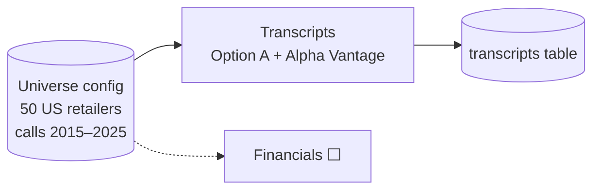
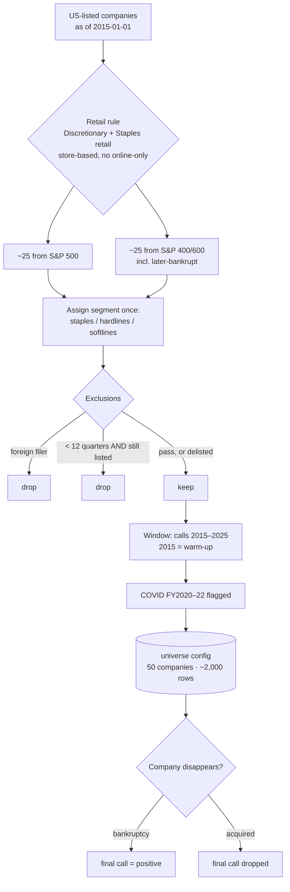
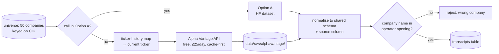

# Spin Check — System Design

Each decision is designed by Vrushank first, then reviewed and finalized here.
Every locked decision gets a Mermaid diagram (renders on GitHub). The overall architecture diagram below grows as decisions lock.

Status: ⬜ pending · 🟡 in review · ✅ locked

| # | Decision | Status |
|---|---|---|
| 1 | Scope & universe | ✅ |
| 2 | Data sources (transcripts, financials) | 🟡 |
| 3 | Label definition ("surprise") | ⬜ |
| 4 | Leakage control | ⬜ |
| 5 | Storage & data model (incl. Chroma vs pgvector) | ⬜ |
| 6 | RAG role & chunking | ⬜ |
| 7 | LLM scoring pipeline | ⬜ |
| 8 | Divergence features | ⬜ |
| 9 | Modelling | ⬜ |
| 10 | Backtest | ⬜ |
| 11 | Pipeline orchestration | ⬜ |
| 12 | API & deployment (FastAPI) | ⬜ |

---

## Overall architecture (grows with each locked decision)

---

## 1. Scope & universe ✅

**Locked:** 2026-10-19

### Decision
| Item | Choice |
|---|---|
| Sector | Retail: GICS Consumer Discretionary retail **+** Consumer Staples retail; store-based only |
| Excluded business types | Online-only retailers (no same-store sales); companies whose profit is mainly non-retail (e.g. CVS) |
| Size | **50 companies**: ~25 from the S&P 500 + ~25 from the S&P MidCap 400 / SmallCap 600 |
| Selection date | Index membership **as of 2015-01-01** (point-in-time, not today's lists) |
| Time window | Earnings calls held **2015-01-01 → 2025-12-31** (by call date, not fiscal year) |
| Warm-up | 2015 calls are history only (YoY + within-company baselines); usable rows start ~2016 |
| COVID | **Included**. `covid_period` flag (~FY2020–FY2022); vs-2019 comparisons for those years; backtest reported with and without |
| Segment feature | Assigned once, manually: `staples` / `discretionary_hardlines` / `discretionary_softlines` |
| Exclusions | Foreign filers (20-F, no quarterly XBRL); companies with < 12 quarters of transcripts **unless they delisted** |
| Delisted companies | Kept. Bankruptcy / distressed delisting → final call labelled **positive**; acquisition → final call dropped |

### Why
- **One sector** keeps narrative comparable: "confident" means roughly the same thing across retailers.
- **Retail** has interpretable fundamentals (comps, margin, inventory, guidance) and plenty of real disappointments.
- **Discretionary + staples** reaches 50 companies; the comparability cost is handled by within-company normalisation (Decision 8) plus the coarse segment feature.
- **Point-in-time selection** puts decliners (Macy's, Kohl's, Gap) and later-bankrupt names (Bed Bath & Beyond, Big Lots, Express, Party City) into the sample. Without them the sample is survivorship-biased.
- **50, not 100:** chosen for scope and cost. The universe is a config list, so the pipeline doesn't depend on its size; going to 100 is a re-run.

### Trade-offs accepted
- ~2,000 usable rows / ~400 positives: enough for logistic regression and GBM, thin for a neural net.
- Small/mid caps have patchier free transcript coverage (see Decision 2).
- The results apply to retail only, by design.

### Known gotchas this creates downstream
- **Offset fiscal calendars** (FY often ends late Jan/early Feb): key everything on fiscal period + filing date (Decisions 2, 4).
- **Seasonality**: all fundamentals comparisons are year-over-year (Decision 3).
- **COVID base effects** would fire 2021–22 labels mechanically; handled by the flag + vs-2019 comparisons (Decision 3).
- **Same-store sales isn't a standard XBRL tag**; it must come from press releases or transcripts (Decision 2).
- **Market-wide mood** (e.g. 2020 "uncertainty"): normalise narrative cross-sectionally per quarter (Decision 8).

### Diagram

---

## 2. Data sources 🟡 (in review)

### 2a. Earnings call transcripts ✅ (locked 2026-10-20)

**Decision: free hybrid.** Option A (Hugging Face `kurry/sp500_earnings_transcripts`) for the calls it has; **Alpha Vantage** (`EARNINGS_CALL_TRANSCRIPT`, free tier) for everything it lacks.

| Rule | Detail |
|---|---|
| Precedence | **Option A wins** when both sources have a call (already downloaded, zero quota). Alpha Vantage is requested only for missing (company, fiscal quarter) pairs |
| What AV fills | Decliners after leaving the S&P 500, companies absent from A (e.g. Gap), small/mid caps, 2025 calls after A ends (2025-05-15) |
| Quota plan | Free tier ~25 requests/day, 5/min → resumable downloader, cache-first, every raw response saved to `data/raw/alphavantage/`, never requested twice. Gap-fill ≈ 1,000 requests ≈ 6 weeks, run in the background while Phases 1–2 use data already on disk |
| Upgrade path | After the gaps, keep downloading AV versions of A's calls (~80 more days). Once complete → switch to **single source (AV)** at zero cost, A becomes validation |
| Join key | Both sources use **fiscal** year/quarter → join on (company, fiscal year, fiscal quarter); `date` = when the call became public |
| Company identity | Key on **SEC CIK**, never ticker. AV files history under the company's **current** ticker (GPS 2019Q2 empty, GAP 2019Q2 returned) → request via a ticker-history map (Decision 5) |
| Wrong-company guard | The company name must appear in the operator's opening line; a reused ticker otherwise imports another company's calls |
| Shared schema | Both sources normalised to: `cik, symbol, fiscal_year, fiscal_quarter, call_date, segment_no, speaker, title, section (prepared/QA), text, source` |
| Confounding guards | `source` column kept, **never a feature**; backtest reported per source; overlap calls scored from both sources: narrative scores must agree before mixing is trusted |
| Forbidden fields | AV `sentiment` (and any vendor sentiment/summary): third-party, hindsight-leakage risk, replaces the project's own scoring |
| Repo hygiene | `data/` and `.env` git-ignored; code is public, transcripts never are |

**Evidence:** `notebooks/01_explore_transcripts.ipynb` (A's coverage: BBBY ends 2018-04, KSS/M end 2021-02/03, Gap/JCP absent, `company_name` 27% missing, 0 duplicates, ends 2025-05-15) and `notebooks/02_test_alphavantage.ipynb` (AV: BBBY 2021Q2, GAP 2019Q2, BGFV 2017Q2, M 2018Q1 all speaker-split with Q&A; Macy's overlap Jaccard 0.80 vs ~0.32 → same call, fiscal quarters).

**Rejected:** API Ninjas Developer ($39: 5-year history only, no speaker split); API Ninjas Business ($99: not needed once AV free passed); 8-K press releases as a transcript source (no Q&A → source-label confounding; still useful for guidance and same-store sales, see 2c).

### 2b. Financials ⬜ · 2c. Same-store sales + guidance ⬜ · 2d. Index membership + delisting reasons ⬜
Still to design.

---
