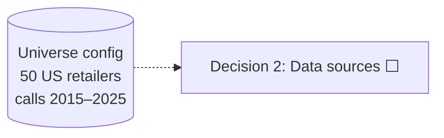
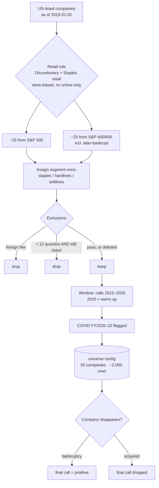

# Spin Check — System Design

Each decision is designed by Vrushank first, then reviewed and finalized here.
Every locked decision gets a Mermaid diagram (renders on GitHub). The overall architecture diagram below grows as decisions lock.

Status: ⬜ pending · 🟡 in review · ✅ locked

| # | Decision | Status |
|---|---|---|
| 1 | Scope & universe | ✅ |
| 2 | Data sources (transcripts, financials) | ⬜ |
| 3 | Label definition ("surprise") | ⬜ |
| 4 | Leakage control | ⬜ |
| 5 | Storage & data model (incl. Chroma vs pgvector) | ⬜ |
| 6 | RAG role & chunking | ⬜ |
| 7 | LLM scoring pipeline | ⬜ |
| 8 | Divergence features | ⬜ |
| 9 | Modelling | ⬜ |
| 10 | Backtest | ⬜ |
| 11 | Pipeline orchestration | ⬜ |
| 12 | API & deployment (FastAPI) | ⬜ |

---

## Overall architecture (grows with each locked decision)

---

## 1. Scope & universe ✅

**Locked:** 2026-10-19

### Decision
| Item | Choice |
|---|---|
| Sector | Retail: GICS Consumer Discretionary retail **+** Consumer Staples retail; store-based only |
| Excluded business types | Online-only retailers (no same-store sales); companies whose profit is mainly non-retail (e.g. CVS) |
| Size | **50 companies**: ~25 from the S&P 500 + ~25 from the S&P MidCap 400 / SmallCap 600 |
| Selection date | Index membership **as of 2015-01-01** (point-in-time, not today's lists) |
| Time window | Earnings calls held **2015-01-01 → 2025-12-31** (by call date, not fiscal year) |
| Warm-up | 2015 calls are history only (YoY + within-company baselines); usable rows start ~2016 |
| COVID | **Included**. `covid_period` flag (~FY2020–FY2022); vs-2019 comparisons for those years; backtest reported with and without |
| Segment feature | Assigned once, manually: `staples` / `discretionary_hardlines` / `discretionary_softlines` |
| Exclusions | Foreign filers (20-F, no quarterly XBRL); companies with < 12 quarters of transcripts **unless they delisted** |
| Delisted companies | Kept. Bankruptcy / distressed delisting → final call labelled **positive**; acquisition → final call dropped |

### Why
- **One sector** keeps narrative comparable: "confident" means roughly the same thing across retailers.
- **Retail** has interpretable fundamentals (comps, margin, inventory, guidance) and plenty of real disappointments.
- **Discretionary + staples** reaches 50 companies; the comparability cost is handled by within-company normalisation (Decision 8) plus the coarse segment feature.
- **Point-in-time selection** puts decliners (Macy's, Kohl's, Gap) and later-bankrupt names (Bed Bath & Beyond, Big Lots, Express, Party City) into the sample. Without them the sample is survivorship-biased.
- **50, not 100:** chosen for scope and cost. The universe is a config list, so the pipeline doesn't depend on its size; going to 100 is a re-run.

### Trade-offs accepted
- ~2,000 usable rows / ~400 positives: enough for logistic regression and GBM, thin for a neural net.
- Small/mid caps have patchier free transcript coverage (see Decision 2).
- The results apply to retail only, by design.

### Known gotchas this creates downstream
- **Offset fiscal calendars** (FY often ends late Jan/early Feb): key everything on fiscal period + filing date (Decisions 2, 4).
- **Seasonality**: all fundamentals comparisons are year-over-year (Decision 3).
- **COVID base effects** would fire 2021–22 labels mechanically; handled by the flag + vs-2019 comparisons (Decision 3).
- **Same-store sales isn't a standard XBRL tag**; it must come from press releases or transcripts (Decision 2).
- **Market-wide mood** (e.g. 2020 "uncertainty"): normalise narrative cross-sectionally per quarter (Decision 8).

### Diagram

---
