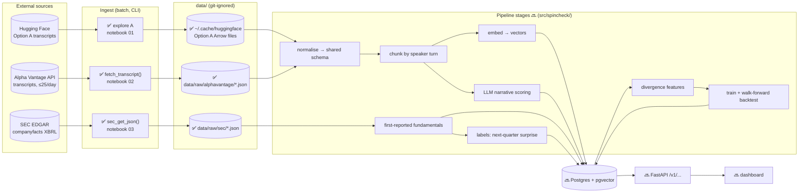
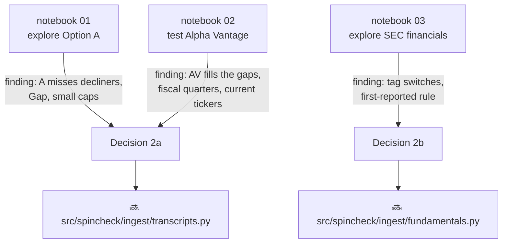
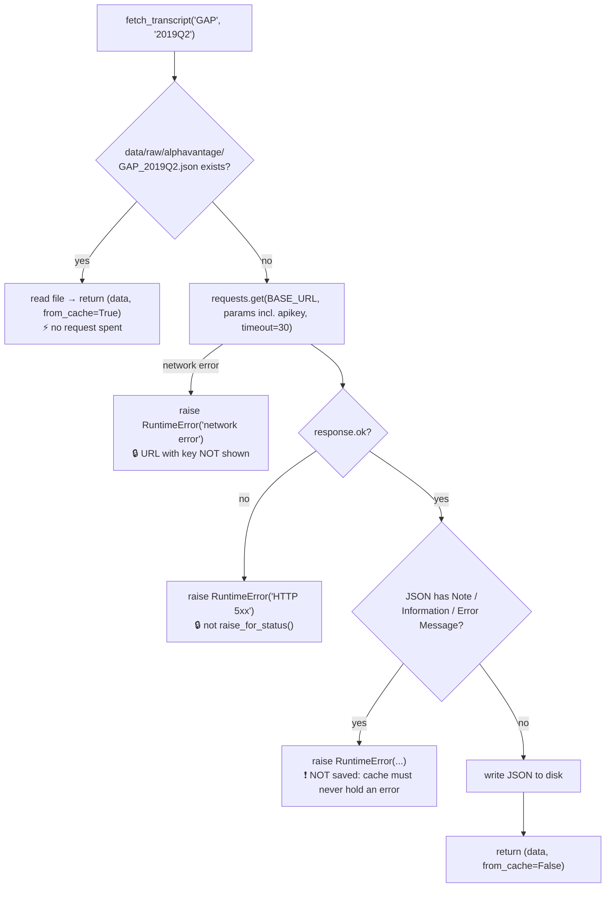
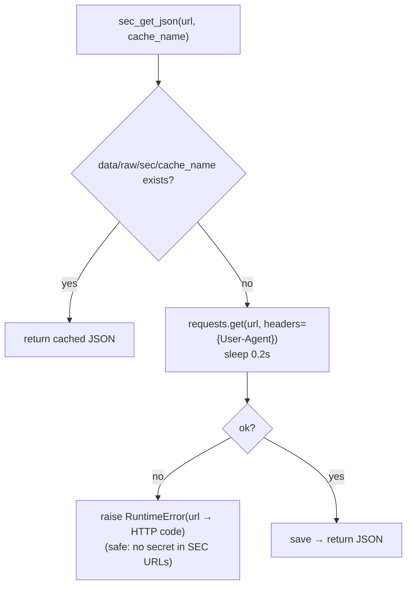
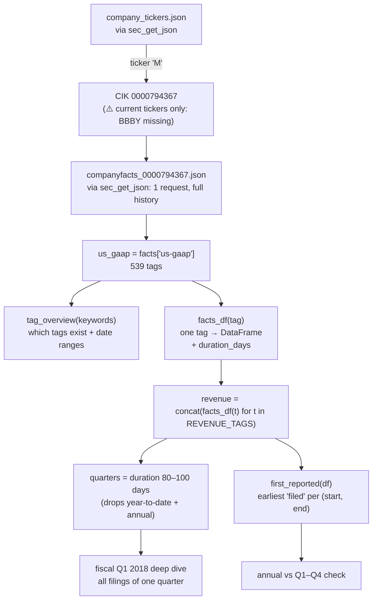
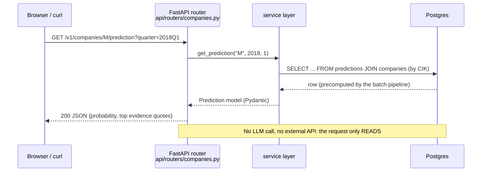

# Spin Check: How the Code Connects

Read this before reading the code. It answers three questions:
1. **What is connected to what?** (the system map)
2. **What happens when I run X?** (one flow per function or cell)
3. **Where does data live, and who writes or reads it?** (the data map)

Status markers: ✅ **exists now** · 🔜 **planned** (designed in `DESIGN.md`, not written yet).
Updated every time code changes. If a diagram and the code disagree, the code wins and this file gets fixed.

*Last updated: 2026-10-20 (notebooks 01–03 exist; no `src/` package yet).*

---

## 1. The system map: the whole app, end to end



**How to read it:** data only flows **left to right**. Batch stages (CLI, run by you) do all the heavy work and write to the database. The API only **reads** precomputed results (the "thin API" rule from the design). Nothing on the right ever calls a paid external API.

---

## 2. What exists now: the three notebooks

Notebooks are **exploration**, not the app. Each one answers a design question. The useful functions in them (`fetch_transcript`, `sec_get_json`, `facts_df`, `first_reported`) are first drafts of 🔜 `src/spincheck/` modules.



---

## 3. Function flows: "what happens if I run this?"

### 3.1 `fetch_transcript(symbol, quarter)`: notebook 02 ✅

**Called by:** the "Run the test calls" loop. **Calls:** `requests.get` (only on a cache miss). **Writes:** `data/raw/alphavantage/{SYMBOL}_{QUARTER}.json`.



**The loop that calls it:**

```mermaid
sequenceDiagram
    participant Loop as run-calls cell
    participant F as fetch_transcript()
    participant Disk as data/raw/alphavantage/
    participant AV as Alpha Vantage
    loop for each (symbol, quarter) in TEST_CALLS
        Loop->>F: fetch_transcript(symbol, quarter)
        F->>Disk: cached?
        alt cache hit
            Disk-->>F: JSON
        else cache miss
            F->>AV: GET ?function=EARNINGS_CALL_TRANSCRIPT
            AV-->>F: JSON (HTTP 200 even on errors)
            F->>Disk: save (only if no error key)
        end
        F-->>Loop: (data, from_cache)
        Loop->>Loop: results[(symbol, quarter)] = data
        Note over Loop: sleep 15s only after a REAL request
    end
```

**Downstream:** `results` feeds `describe()` (prints keys + first segments), the summary-table cell, and the Macy's Jaccard overlap cell (which also loads Option A from the Hugging Face cache).

### 3.2 `sec_get_json(url, cache_name)`: notebook 03 ✅

Same cache-first shape as `fetch_transcript`, but with a **User-Agent header** (name + email from `.env`) and a 0.2 s pause. **Writes:** `data/raw/sec/company_tickers.json`, `data/raw/sec/companyfacts_{CIK10}.json`.



### 3.3 Notebook 03, end to end: from ticker to first-reported quarterly revenue ✅



**Key idea:** `facts_df` produces *every* report of a number; `first_reported` collapses those to **what was public first**. That's the leakage rule (Decision 4) in one function.

---

## 4. The data map: who writes and who reads

| Location | Written by | Read by | In git? |
|---|---|---|---|
| `.env` | you (by hand) | `load_dotenv` in notebooks 02, 03 | ❌ never |
| `data/raw/alphavantage/*.json` | `fetch_transcript()` | notebook 02 cells; 🔜 normalise stage | ❌ |
| `data/raw/sec/*.json` | `sec_get_json()` | notebook 03 cells; 🔜 fundamentals stage | ❌ |
| `~/.cache/huggingface/` | `load_dataset()` (notebooks 01, 02) | same | ❌ (outside the repo) |
| `docs/DESIGN.md` | design reviews | you, interviewers | ✅ |
| `docs/FLOW.md` | updated with every code change | you, before reading code | ✅ |
| `docs/NOTES.md` | updated at the end of each session | you, before interviews | ✅ |

---

## 5. The planned app: what one API request will trigger 🔜

Shown so you can see where today's functions end up. Nothing here exists yet.



The same **router → service → repository → database** layering as your webhook service.

---

## 6. Rule for keeping this file honest
When code is added or changed: update the matching section here **in the same commit**: new function → new flow in §3, new file location → new row in §4, notebook logic moved into `src/` → flip 🔜 to ✅ in §1.
